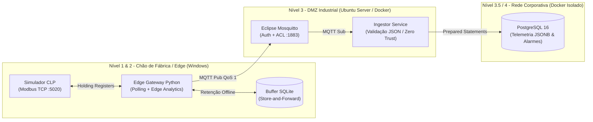

# IIoT Purdue DMZ Architecture (`iiot-purdue-dmz-architecture`)

Arquitetura de referência para convergência segura entre **Tecnologia Operacional (OT)** e **Tecnologia da Informação (IT)** baseada no **Modelo Purdue (ISA-95)** e diretrizes da norma **ISA/IEC 62443**.

O projeto demonstra o ciclo completo de telemetria industrial: aquisição determinística via **Modbus TCP**, processamento e retenção offline (*Store-and-Forward*) em **Edge Gateway**, mensageria autenticada com controle de acesso por tópico (**MQTT + ACL**) em Zona Desmilitarizada (**DMZ**), validação *Zero Trust* de payload e persistência histórica em **PostgreSQL**.

---

## Arquitetura do Sistema



---

## Estrutura do Repositório

```text
iiot-purdue-dmz-architecture/
├── docs/
│   └── 01-arquitetura-purdue.md      # Especificação técnica das camadas, ACLs e resiliência
├── edge-gateway-windows/
│   ├── simulador_clp.py              # Servidor Modbus TCP simulando processo hidráulico
│   ├── gateway_edge.py               # Coletor Modbus -> MQTT com Edge Analytics e buffer SQLite
│   └── requirements.txt              # Dependências travadas da camada de borda
├── ingestor-service/
│   ├── ingestor.py                   # Consumidor MQTT com validação de schema e gravação SQL
│   ├── Dockerfile                    # Imagem Python slim isolada
│   └── requirements.txt              # Dependências do serviço de ingestão
└── server-dmz-docker/
    ├── docker-compose.yml            # Orquestração com redes isoladas (dmz_ot_net / it_db_net)
    ├── mosquitto/config/
    │   ├── mosquitto.conf            # Configuração do Broker (anonymous disabled)
    │   ├── aclfile                   # Matriz de autorização por usuário e tópico
    │   └── passwd.example            # Template de geração de credenciais
    └── postgres/
        └── init.sql                  # DDL das tabelas de telemetria (JSONB + GIN) e alarmes
```

---

## Estado Atual e Roadmap de Engenharia

- [x] **Fase 1 — Infraestrutura DMZ & Historiador:** Broker Mosquitto com ACL e PostgreSQL 16 rodando em redes Docker segregadas.
- [x] **Fase 2 — Serviço de Ingestão (Zero Trust):** Ponte segura entre DMZ e rede IT com rejeição de payloads malformados/injeção.
- [x] **Fase 3 — Camada de Borda (Edge Windows):** Simulador Modbus TCP + Gateway Python com detecção local de anomalias e fila offline SQLite.
- [ ] **Fase 4 — Hardening de Rede (`DOCKER-USER`):** Regras `iptables` bloqueando acesso direto ao banco e restringindo portas por IP de origem + testes documentados de intrusão e queda de link.
- [ ] **Fase 5 — Camada Física & IHM Móvel:** Integração de hardware ESP32 (sensores ambientais/tamper + controle em malha fechada via relé) e painel operacional móvel.
